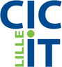

# Younes IKLI — Ingénieur de données

  
  

    

      
      &nbsp;
      
      &nbsp;
      
    

    
<strong>Disponible immédiatement</strong>

  

---

## À propos

Ingénieur de données, je conçois des chaînes de données fiables, traçables et conformes aux exigences métier, avec Python, SQL et dbt, et une expérience approfondie des données de santé.

En trois ans, j'ai contribué à la plateforme de données d'un projet européen d'apprentissage décentralisé entre hôpitaux, consolidé la chimiothèque d'une biotech de repositionnement de médicaments, mené un projet de machine learning sur une cohorte de patients avec le CHU de Lille, et automatisé des rapports d'activité PMSI réutilisables pour chaque établissement de santé. Ces compétences se transposent directement à d'autres secteurs exigeants : retail, banque, assurance, service public.

Ma façon de travailler : partir du besoin des équipes métier, être force de proposition, garantir la confidentialité et la qualité de chaque donnée, et appliquer les bonnes pratiques du génie logiciel : tests, CI/CD, versioning et documentation.

Mon parcours s'est construit progressivement : l'enseignement d'abord, puis une reprise d'études en informatique et en data, menée en parallèle de la formation et de l'enseignement, avant de me consacrer entièrement à la data. J'en garde la capacité à rendre un sujet technique clair pour les équipes métier.

**[Voir les projets →](./projets/index.md)**

---

## Stack technique

  

    
Langages

    

      Python
      SQL
      Bash
    

  

  

    
Transformation

    

      dbt
      Airflow
    

  

  

    
Cloud & Données

    

      GCP
      BigQuery
      PostgreSQL
      Qdrant
      SQLite
    

  

  

    
DevOps

    

      Docker
      GitLab CI
      GitHub Actions
      Terraform
      Git
    

  

  

    
IA & ML

    

      Scikit-learn
      LLM
      RAG
      LangChain
      LangGraph
    

  

---

## Expériences

  

    

      <strong>INRIA — Ingénieur R&amp;D data (CDD)</strong>
      Lille · Sept. 2024 – Avr. 2026
    

    
Plateforme de recherche clinique sur le cancer de la prostate, au sein d'un projet européen : les chercheurs analysent les données de plusieurs hôpitaux sans que la donnée patient ne quitte jamais l'hôpital (architecture fédérée, déployée sur site). Au sein d'une équipe de six ingénieurs : pipelines Python et dbt, tests automatiques et vérification de conformité au schéma d'échange commun à tous les sites, intégration continue avec GitLab CI et conteneurisation Docker pour un déploiement autonome par chaque hôpital, documentation (MkDocs). Une première version est installée dans trois hôpitaux pilotes. Projet mené en anglais.

  

  

    

      <strong>APTEEUS — Data Engineer (Alternance)</strong>
      Lille · Jan. – Juil. 2023
    

    
Biotech qui repositionne des médicaments existants pour soigner des maladies rares. Chimiothèque interne enrichie par plusieurs sources externes (bases moléculaires, chimiothèques). En tant que seul profil technique du projet : schéma validé avec les équipes métier, pipelines de déduplication, de normalisation et de fusion garantissant la qualité des données et la traçabilité de chaque information, interface simple permettant à l'équipe de relancer les traitements en autonomie. Résultat : un référentiel de composés unique et fiable (<strong>MDM</strong>).

  

  

    

      <strong>CHU de Lille &amp; CIC-IT — Ingénieur Machine Learning (Projet de Master)</strong>
      Lille · Sept. 2022 – Juin 2023
    

    
Classification des crises d'épilepsie à partir de la variabilité de la fréquence cardiaque, sur des données cliniques déséquilibrées issues d'une cohorte de patients : préparation des données, feature engineering, entraînement et évaluation de modèles (Scikit-learn). Le projet a mis en évidence la faisabilité de la détection des crises à partir d'un signal cardiaque.

  

  

    

      <strong>Alicante (OSPI) — Analytics Engineer (Stage)</strong>
      Lille · Avr. – Août 2022
    

    
Valorisation de données hospitalières par l'IA. Automatisation des rapports d'analyse d'activité PMSI réalisés pour chaque nouvel établissement de santé : contrôle de la qualité des données, calcul des indicateurs de pilotage et rapports multi-formats, avec un même traitement réutilisable d'un établissement à l'autre.

  

  

    

      <strong>Enseignant, formateur et tuteur en informatique</strong>
      1999 – 2023
    

    
Enseignement en primaire, puis enseignement de l'informatique au collège et au lycée ; formations techniques au sein d'une association dédiée à Linux et à l'open source (Linux, algorithmique, bases de données), et tutorat Python à l'Université de Lille (2021–2023).

  

---

## Formation

**Master Data Science en santé** — Université de Lille · 2023  
**Master MEEF Informatique** — Université de Lille · 2021  
**Licence Mathématiques & Informatique – Génie logiciel** — Université Ibn Zohr (Maroc) · 2015

---

## Bénévolats & Associations

- **Membre du Conseil de Développement de la MEL — France** *(Métropole Européenne de Lille)* — participation aux orientations stratégiques du territoire. · *depuis 2025*
- **Conseiller (ex-président) de l'association [ALIS](https://alis.asso.ma/) — Maroc** *(promotion du logiciel libre, open source et Linux)* · *depuis 2008*

---
