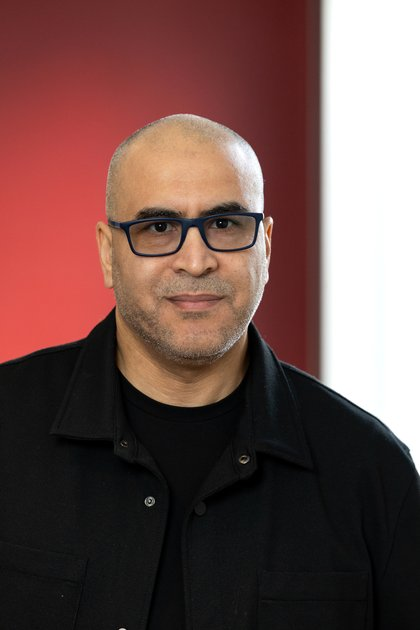

# Younes IKLI — Data Engineer santé

  
  

    

      
      &nbsp;
      
      &nbsp;
      
    

    
<strong>Disponible immédiatement</strong>

  

---

## À propos

Data Engineer depuis trois ans, j'ai travaillé sur des projets de santé et de recherche : une plateforme de recherche clinique déployée dans trois hôpitaux européens, la chimiothèque d'une biotech, des données cliniques au CHU de Lille, et l'automatisation des rapports d'activité PMSI, réutilisables pour chaque nouvel établissement de santé.

Mon master en data science appliquée à la santé m'a donné les bases du domaine. Ces projets m'en ont appris les exigences : la confidentialité des données patient, la qualité et la traçabilité de chaque donnée. J'y applique les bonnes pratiques du développement logiciel : cadrage du besoin, tests, CI/CD, versioning et documentation.

J'ai commencé ma carrière dans l'enseignement, puis j'ai repris mes études par passion, en licence puis en master. De l'enseignement, j'ai gardé le goût de comprendre les problèmes et celui de transmettre. Je travaille facilement avec des profils non techniques et dans des équipes pluridisciplinaires : cliniciens, chercheurs, chimistes, équipes métier. Je sais vulgariser un sujet technique et en faire une synthèse claire, pour que chacun puisse décider.

**[Voir les projets →](./projets/index.md)**

---

## Les données de santé avec lesquelles j'ai travaillé

| Données | Contexte | Enjeux |
|---|---|---|
| Données de recherche clinique de plusieurs hôpitaux | Inria, projet européen | la donnée patient ne quitte pas l'hôpital ; un schéma d'échange commun, vérifié automatiquement |
| Signaux physiologiques et données cliniques | CHU de Lille & CIC-IT | données déséquilibrées, rigueur de l'évaluation |
| Données d'activité hospitalière (PMSI) | Alicante, éditeur de logiciels santé | rapports d'activité automatisés, réutilisables pour chaque nouvel établissement |
| Chimiothèque et bases moléculaires | Apteeus, biotech | déduplication, normalisation, traçabilité des sources |
| Documents de recherche pharmaceutique et structures moléculaires | MolScout | confidentialité (100 % local), réponses vérifiées, chimie calculée avec RDKit |

---

## Stack technique

  

    
Données de santé

    

      Recherche clinique multi-hôpitaux
      Architecture fédérée
      Données cliniques
      Activité hospitalière (PMSI)
      Chimio-informatique (RDKit)
      Référentiel de composés (MDM)
    

  

  

    
Langages

    

      Python
      SQL
      Bash
    

  

  

    
Transformation & Orchestration

    

      dbt
      Airflow
    

  

  

    
Cloud & Bases de données

    

      GCP
      BigQuery
      PostgreSQL
      Qdrant
      SQLite
    

  

  

    
Industrialisation

    

      Docker
      GitLab CI
      GitHub Actions
      Terraform
      Git
    

  

  

    
IA & Machine Learning

    

      Scikit-learn
      LLM
      RAG
      LangChain
      LangGraph
    

  

---

## Expériences

  

    

      <strong>INRIA — Ingénieur R&amp;D data (CDD)</strong>
      Lille · Sept. 2024 – Avr. 2026
    

    
Plateforme de recherche clinique sur le cancer de la prostate, au sein d'un projet européen : les chercheurs analysent les données de trois hôpitaux sans que la donnée patient ne quitte jamais l'hôpital (architecture fédérée, déployée sur site). Au sein d'une équipe de six ingénieurs : pipelines Python, dbt et Airflow, tests automatiques et vérification de conformité au schéma d'échange commun à tous les sites, intégration continue avec GitLab CI et conteneurisation Docker pour un déploiement autonome par chaque hôpital, environnement de test sur GCP, documentation (MkDocs). Une première version est installée dans les trois hôpitaux pilotes. Projet mené en anglais.

  

  

    

      <strong>APTEEUS — Data Engineer (Alternance)</strong>
      Lille · Jan. – Juil. 2023
    

    
Biotech de la découverte de médicaments. Chimiothèque interne enrichie par plusieurs sources externes (bases moléculaires, chimiothèques). En tant que seul profil technique du projet : schéma validé avec les équipes métier, pipelines de déduplication, de normalisation et de fusion garantissant la qualité des données et la traçabilité de chaque information, interface simple permettant à l'équipe de relancer les traitements en autonomie. Résultat : un référentiel de composés unique et fiable (<strong>MDM</strong>).

  

  

    

      <strong>CHU de Lille &amp; CIC-IT — Ingénieur Machine Learning (Projet de Master)</strong>
      Lille · Sept. 2022 – Juin 2023
    

    
Classification des crises d'épilepsie à partir de la variabilité de la fréquence cardiaque, sur des données cliniques déséquilibrées : préparation des données, feature engineering, entraînement et évaluation de modèles (Scikit-learn). Le projet a mis en évidence la faisabilité de la détection des crises à partir d'un signal cardiaque.

  

  

    

      <strong>Alicante (OSPI) — Analytics Engineer (Stage)</strong>
      Lille · Avr. – Août 2022
    

    
Éditeur de logiciels pour les établissements de santé. Automatisation des rapports d'analyse d'activité PMSI réalisés pour chaque nouvel établissement client d'un groupe hospitalier : contrôle de la qualité des données, calcul des indicateurs de pilotage et rapports multi-formats, avec un même traitement réutilisable pour chaque nouvel établissement de santé.

  

  

    

      <strong>Enseignant, formateur et tuteur en informatique</strong>
      1999 – 2023
    

    
Enseignement en primaire, puis enseignement de l'informatique au collège et au lycée ; formations techniques au sein d'une association dédiée à Linux et à l'open source (Linux, algorithmique, bases de données), et tutorat Python à l'Université de Lille (2021–2023).

  

---

## Formation

**Master Data Science en santé** — Université de Lille · 2023  
**Master MEEF Informatique** — Université de Lille · 2021  
**Licence Mathématiques & Informatique – Génie logiciel** — Université Ibn Zohr (Maroc) · 2015

---

## Bénévolats & Associations

- **Membre du Conseil de Développement de la MEL — France** *(Métropole Européenne de Lille)* — participation aux orientations stratégiques du territoire. · *depuis 2025*
- **Conseiller (ex-président) de l'association ALIS — Maroc** *(promotion du logiciel libre, open source et Linux)* · *depuis 2008*

---
