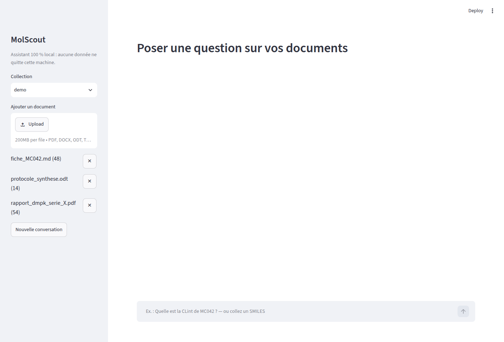
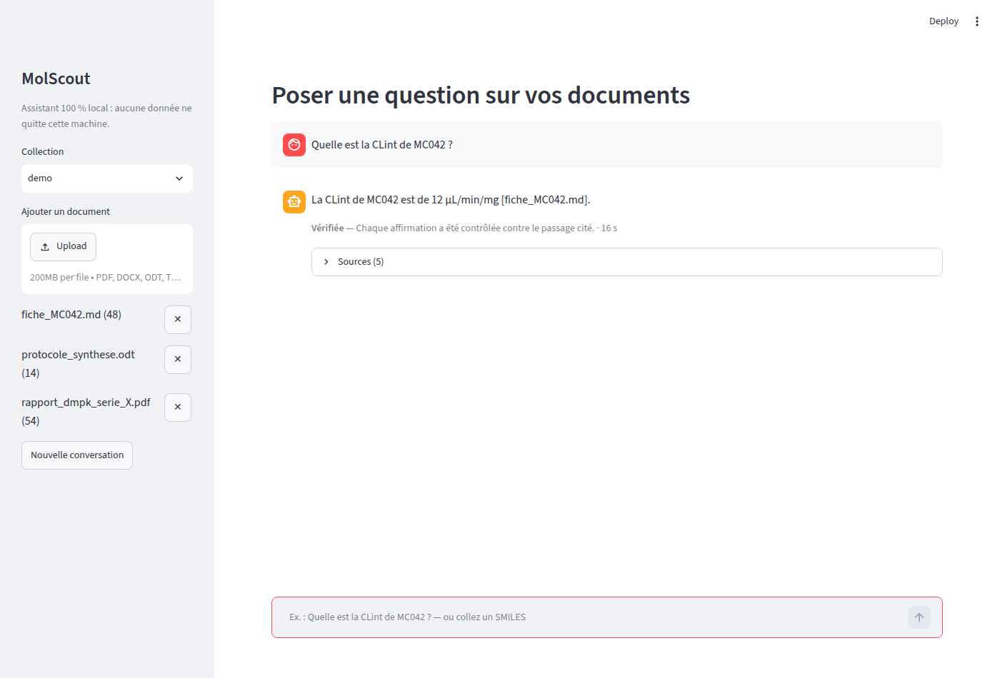

# MolScout

**Un seul outil pour interroger ses documents de recherche et analyser ses molécules.** MolScout se connecte à une base de documents internes (rapports d'études, fiches de composés, protocoles), répond aux questions d'un chimiste en citant le passage exact qui justifie chaque réponse, et intègre dans la même interface les outils de chémoinformatique dont il a besoin. Il fonctionne entièrement en local : aucune donnée ne quitte l'entreprise.

> **Stack :** Python · LangChain · LangGraph · Ollama · Qdrant · RDKit · FastAPI · Streamlit
>
> **Code source disponible sur demande** (dépôt privé).

---

## Le besoin

Dans une équipe de drug discovery, l'information est dispersée et sensible :

- **Des documents confidentiels, difficiles à interroger.** Les résultats d'une série de composés sont répartis entre des dizaines de rapports, de tableaux et de protocoles. Retrouver une valeur précise (une clairance, une IC50, une solubilité) prend du temps.
- **Des structures que l'IA doit comprendre.** Un composé est décrit par son identifiant interne et par son SMILES, qui peut s'écrire de plusieurs façons. Un assistant généraliste ne reconnaît pas qu'il s'agit de la même molécule, confond deux analogues voisins ou invente une valeur plausible.
- **Des allers-retours entre logiciels.** Le chimiste cherche une information dans un document, copie un SMILES dans un outil de chémoinformatique, calcule des propriétés ailleurs, puis revient à ses rapports.
- **Une contrainte de confidentialité.** Molécules candidates, résultats d'essais et brevets ne peuvent pas être envoyés vers un assistant en ligne.

## La solution

MolScout réunit ces usages dans une seule application locale :

- **Interroger ses documents en langage naturel.** « Quelle est la clairance microsomale de ce composé ? » : la réponse est citée `[fichier, p.N]` et vérifiée avant d'être affichée.
- **Travailler directement sur une structure.** Le chimiste colle un SMILES : MolScout reconnaît la molécule quelle que soit son écriture, la relie aux documents qui en parlent et calcule ses propriétés.
- **Utiliser la chémoinformatique sans changer d'outil.** Descripteurs moléculaires, règle de Lipinski, similarité de Tanimoto, recherche de sous-structure et cohérence entre valeurs déclarées et calculées sont disponibles dans la même conversation.
- **Enchaîner les questions.** Les questions de suivi (« et son CLint ? ») sont comprises dans le contexte de la session.

## L'interface

MolScout s'utilise dans une application web locale (Streamlit), ouverte dans le navigateur, sur un seul écran :

- **À gauche, les documents** : choix de la collection, ajout et indexation d'un document (PDF, DOCX, ODT, Markdown), liste des documents indexés avec le nombre de passages de chacun.
- **Au centre, la conversation** : le chimiste pose sa question en langage naturel ou colle un SMILES. Chaque réponse affiche son statut (« Vérifiée », « Partielle » ou « Abstention »), son temps de calcul et ses sources.
- **Les sources en un clic** : les passages exacts qui justifient la réponse, avec le nom du document et la page.
- **La chimie dans la conversation** : quand un SMILES apparaît dans une question, sa structure 2D et ses descripteurs calculés par RDKit s'affichent directement dans l'échange.

## Trois principes de conception

- **Chimie calculée, pas devinée.** Toutes les propriétés des molécules viennent de RDKit et d'une chimiothèque locale, jamais du modèle de langage.
- **Vérification, pas confiance.** Chaque affirmation est contrôlée, sans LLM, contre le passage qu'elle cite : extrait littéral, valeur, unité et composé. Si le contrôle échoue, le système relance une génération guidée, puis répond partiellement ou s'abstient plutôt que d'affirmer à tort.
- **Local de bout en bout.** Modèle de langage exécuté sur la machine, aucun appel réseau sortant, télémétrie désactivée, déploiement Docker sur réseau interne.

## Où en est le projet

MolScout est un **prototype fonctionnel** : ingestion des documents, recherche, outils de chémoinformatique, vérification des réponses et interface sont en place et fonctionnent ensemble.

Le projet est construit comme un logiciel destiné à être utilisé, pas comme une démonstration :

- **Évaluation automatisée** : un jeu de questions vérifiables et un scoreur déterministe mesurent la qualité des réponses à chaque évolution.
- **Barrière de non-régression** : l'intégration continue bloque toute version qui ferait moins bien que la précédente.
- **Qualité logicielle** : plus de 300 tests automatisés, analyse statique, image Docker vérifiée sans accès réseau sortant.

## Perspectives

- **Valider sur des documents réels**, anonymisés ou non confidentiels, avec des chimistes.
- **Réduire le temps de réponse**, avec un modèle plus léger ou un GPU.
- **Enrichir l'interface** : aperçu du document cité à côté de la réponse, et panneau de chémoinformatique permanent pour comparer plusieurs molécules.
- **Se connecter à d'autres sources documentaires** de l'entreprise, au-delà des fichiers déposés.
- **Enrichir les outils de chémoinformatique** selon les besoins des équipes.

## Ce que le système fait

| Capacité | Détail |
|---|---|
| Ingestion PDF, DOCX, ODT, Markdown | Passages structurés (en-tête, section, page) ; identifiants de composés et SMILES extraits ; propriétés déclarées contrôlées contre RDKit ; ingestion idempotente |
| Questions sur documents | Récupération hybride (dense + lexicale) avec filtre par composé ; réponses citées et vérifiées |
| Questions sur une structure | SMILES reconnu quelle que soit son écriture ; propriétés, similarité, sous-structure, cohérence déclaré/calculé |
| Conversation | Questions de suivi résolues dans la session |
| Interface | Application web locale (Streamlit) : statut de vérification, sources, structure 2D |

## Architecture

```
Documents ─► extraction ─► passages structurés ─► embeddings + lexical ─► Qdrant
                                     └─► chimiothèque (SQLite)
Question ─► contexte ─► routeur (entités) ─┬─► récupération hybride ─┐
                                           └─► outils RDKit ─────────┤
                                                                     ▼
                                   génération structurée ─► vérification déterministe ─► réponse citée / abstention
```

Composants : LangGraph orchestre le graphe (récupération, outils, génération, vérification) ; Ollama exécute le LLM et les embeddings en local ; Qdrant assure la recherche vectorielle ; RDKit la chimie ; SQLite la chimiothèque ; FastAPI l'API ; Streamlit l'interface.

## Aperçu

### Interface principale


*À gauche, les documents indexés et l'ajout de nouveaux fichiers ; au centre, la zone de question. Tout fonctionne en local.*

### Réponse vérifiée


*Une question sur un composé : la réponse cite son document source, porte le statut « Vérifiée » et affiche son temps de calcul.*

### Sources citées


*Les passages exacts qui justifient la réponse, avec leur document et leur page : le chimiste peut tout contrôler en un clic.*
