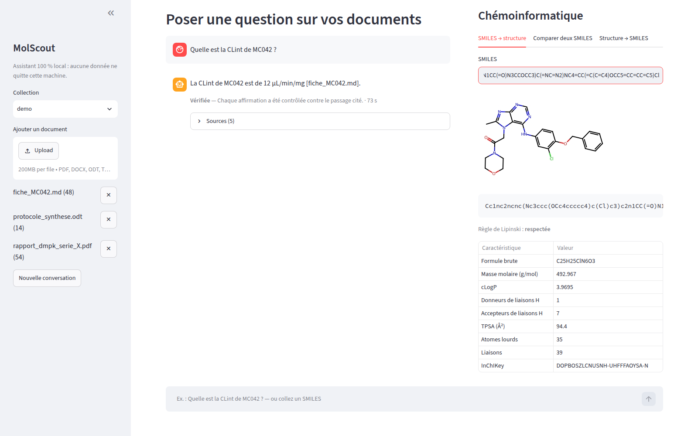
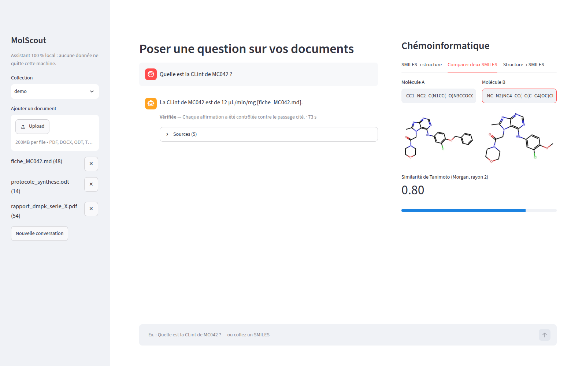
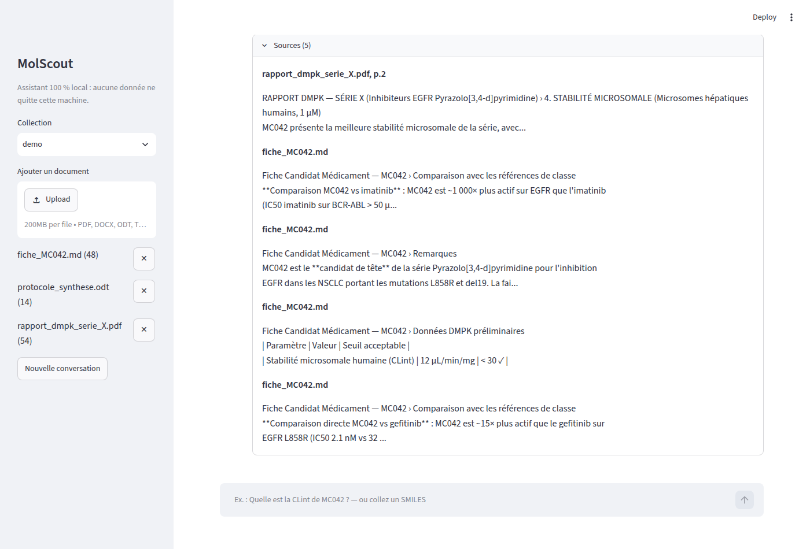

# MolScout

**Interroger ses documents de recherche et analyser ses molécules dans un seul outil, entièrement en local.**

> **Stack :** Python · LangChain · LangGraph · Ollama · Qdrant · RDKit · FastAPI · Streamlit · Docker

---

## Problématique

Dans une équipe de drug discovery :

- **Les documents sont nombreux et confidentiels.** Les résultats d'une série de composés sont dispersés entre rapports, tableaux et protocoles. Retrouver une valeur précise prend du temps, et ces documents ne peuvent pas être envoyés vers une IA en ligne.
- **Les molécules sont difficiles à interpréter pour une IA généraliste.** Un même composé peut s'écrire de plusieurs façons (SMILES). Un assistant classique confond des molécules voisines ou invente une valeur plausible.
- **Le chimiste jongle entre plusieurs logiciels** : un pour chercher dans ses documents, un autre pour analyser ses molécules.

## Ce que j'ai construit

- **Une application unique et locale** : à gauche les documents, au centre la conversation, à droite un panneau de chémoinformatique (structure d'un SMILES, caractéristiques, comparaison de deux molécules, fichier de structure vers SMILES).
- **Des réponses citées** : chaque réponse renvoie au passage exact du document (fichier et page). La recherche combine le sens et les mots-clés, avec un filtre par composé pour ne pas mélanger les molécules.
- **Une chimie calculée, jamais devinée** : les molécules sont reconnues quelle que soit leur écriture, et leurs propriétés (descripteurs, règle de Lipinski, similarité, sous-structure) sont calculées par RDKit.
- **Une vérification avant affichage** : chaque affirmation est contrôlée contre sa source, sans LLM. Si elle n'est pas prouvée, l'assistant répond partiellement ou s'abstient.
- **Une qualité mesurée** : un jeu de questions vérifiables évalue chaque évolution, et l'intégration continue bloque toute version qui ferait moins bien. Plus de 300 tests automatisés, image Docker sans accès réseau sortant.

```
Documents ─► extraction ─► passages structurés ─► recherche hybride (Qdrant)
                                     └─► chimiothèque (SQLite)
Question ─► routeur ─┬─► recherche dans les documents ─┐
                     └─► outils RDKit ─────────────────┤
                                                       ▼
                         génération ─► vérification ─► réponse citée / abstention
```

## Résultat

Un **prototype fonctionnel** de bout en bout : les documents sont indexés, les questions reçoivent une réponse citée et vérifiée, la chimie s'affiche dans la conversation, et l'assistant s'abstient plutôt que d'affirmer sans preuve. Aucune donnée ne quitte la machine.


*Un seul écran : les documents à gauche, une réponse citée et vérifiée au centre, la structure et les caractéristiques de la molécule à droite, calculées par RDKit.*


*La comparaison de deux analogues : les deux structures côte à côte et leur similarité de Tanimoto.*


*Les passages exacts qui justifient la réponse, consultables en un clic.*

## Perspectives

- **Valider l'outil sur des documents réels**, avec des chimistes.
- **Réduire le temps de réponse**, avec un modèle plus léger ou un GPU.
- **Enrichir l'interface** : aperçu du document cité à côté de la réponse, dessin de molécules à la main.
- **Se connecter aux sources documentaires de l'entreprise**, au-delà des fichiers déposés.
