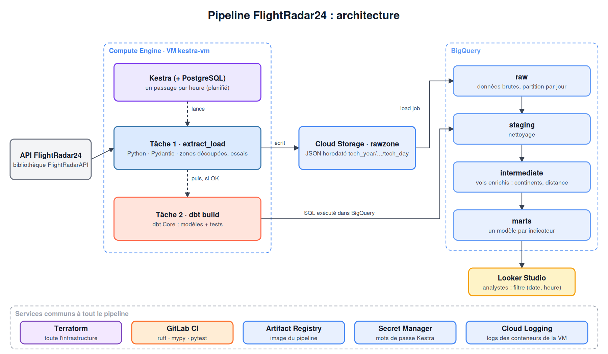
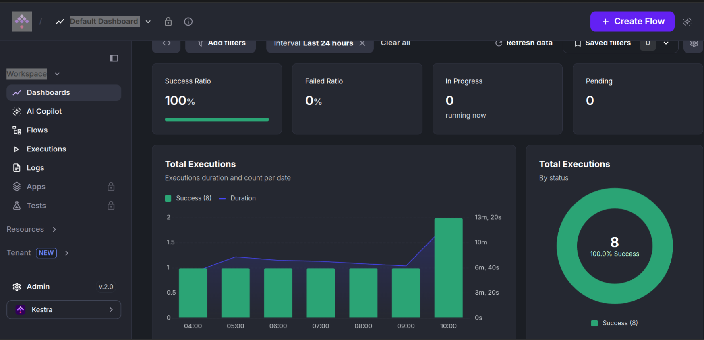
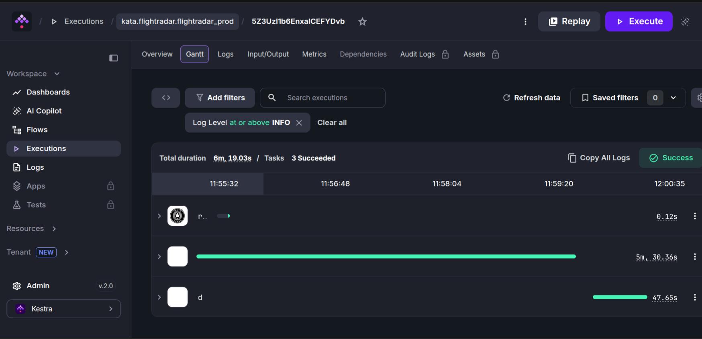
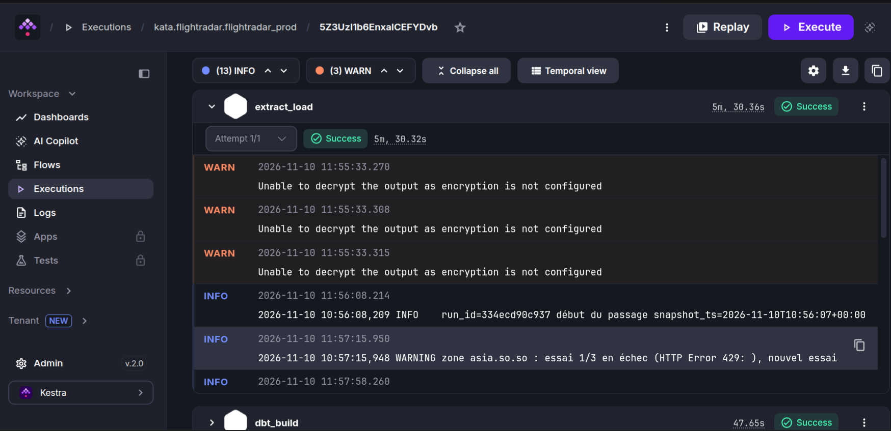
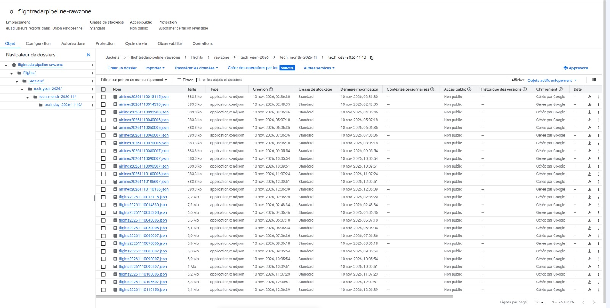
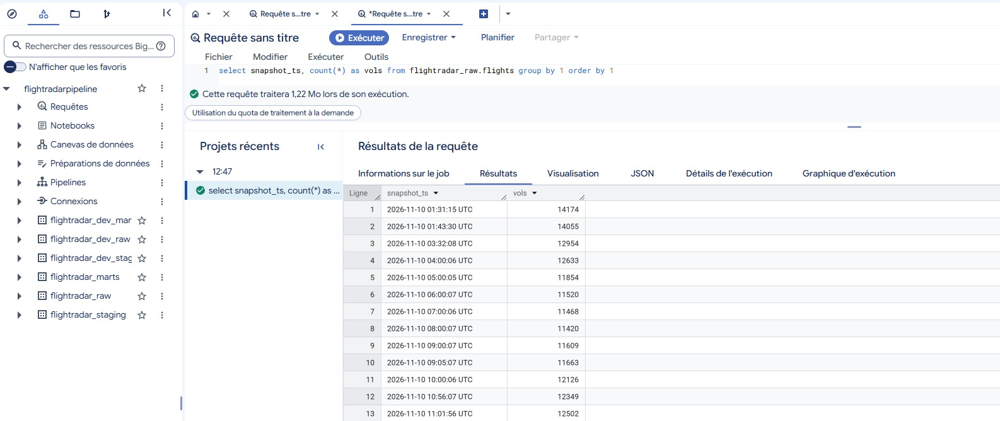
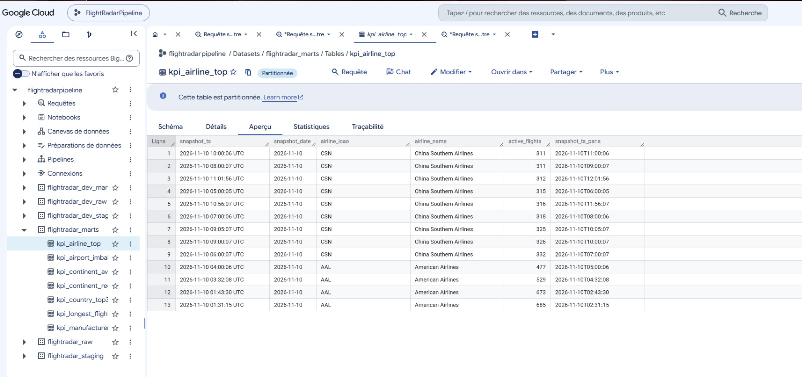
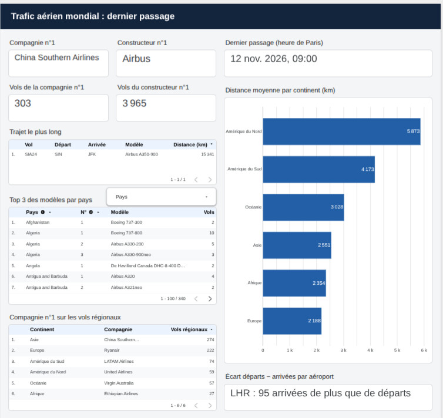

# Pipeline trafic aérien

**Collecter toutes les deux heures tous les vols en cours dans le monde, et en tirer des indicateurs fiables pour n'importe quel jour et n'importe quelle heure.**

> **Stack :** Python · SQL · BigQuery · dbt Core · Kestra · Terraform · Docker · Cloud Storage · Looker Studio
>
> En production sur Google Cloud depuis le 10 novembre 2026 · [Voir le tableau de bord en direct](https://datastudio.google.com/reporting/b5c07eab-7d83-4023-b4ed-4eed4b65e9a8)

---

## Problématique

Le trafic aérien mondial change à chaque minute : à tout moment, des milliers d'avions sont en vol, et cette photo disparaît aussitôt. Pour comprendre le marché, il faut répondre de façon fiable à des questions comme : quelle compagnie a le plus d'avions en l'air, qui domine les vols régionaux sur chaque continent, quel constructeur équipe le plus d'appareils en service, quels modèles chaque pays fait voler.

Une observation ponctuelle ne suffit pas. Il faut prendre cette photo **régulièrement**, la **conserver**, la **nettoyer**, et retrouver les réponses **pour n'importe quel jour et n'importe quelle heure**, sans intervention humaine.

## Ce que j'ai construit

- **Une extraction robuste** : la source renvoie au plus 1 500 vols par appel ; le pipeline découpe le monde en zones, divise en 4 toute zone qui atteint la limite, dédoublonne, retente les zones refusées avec une attente croissante et les rattrape en fin de passage.
- **Une validation à l'entrée** : chaque ligne est vérifiée (Pydantic) ; une ligne illisible part en quarantaine avec la raison, sans bloquer le reste.
- **Un stockage brut horodaté** : chaque passage est conservé tel que reçu dans Cloud Storage, rangé par année, mois et jour, puis chargé dans BigQuery sans doublon, même en cas de relance.
- **Une modélisation dbt** : staging (nettoyage), vue enrichie (continents, distance à vol d'oiseau, constructeur), puis une table incrémentale par indicateur, une ligne par passage. Tests de données à chaque exécution.
- **Des tables de référence publiques** pour ce que la source ne fournit pas : coordonnées des aéroports, pays des compagnies, constructeurs. Une erreur dans la source des pays (des indicatifs radio à la place des pays) a été détectée, corrigée et protégée par un test.
- **Une orchestration en production** : Kestra, sur une VM Google Cloud, lance un passage toutes les deux heures et enchaîne extraction puis transformations, un passage à la fois.
- **Une infrastructure décrite en code** (Terraform) : stockage, entrepôt, comptes de service à droits minimaux, secrets, réseau sans aucun port ouvert, VM.
- **Deux environnements** : développement et production, même code, configuration différente.

## Architecture

## Résultats

- **En production depuis novembre 2026** : 11 000 à 17 000 vols collectés toutes les deux heures, en 6 minutes environ par passage.
- **7 indicateurs** recalculés à chaque passage : compagnies, constructeurs, aéroports et régions.
- **Fiabilité** : deux incidents d'exploitation (quota BigQuery, espace disque) diagnostiqués et corrigés durablement. Aucune perte de données, grâce à la conservation des fichiers bruts.
- **Coûts maîtrisés** : environ 1 $ par jour, grâce aux tables partitionnées, aux modèles incrémentaux et aux plafonds de requêtes.
- **Qualité** : 25 tests Python (93 % de couverture) et 70 étapes dbt (modèles, tests de données, tests unitaires).

## Captures

### Les passages du premier jour

### Déroulé d'un passage

Les tâches s'enchaînent : jeton d'accès, extraction et chargement, puis transformations dbt.

### Logs d'un passage

### Stockage brut horodaté

Les fichiers bruts rangés par année, mois et jour, l'heure du passage dans le nom.

### Passages dans BigQuery

### Un indicateur, passage par passage

La nuit, American Airlines est en tête ; le jour, China Southern Airlines.

### Tableau de bord Looker Studio

[Ouvrir le tableau de bord Looker Studio](https://datastudio.google.com/reporting/b5c07eab-7d83-4023-b4ed-4eed4b65e9a8)

## Perspectives

- **Alertes automatiques** : prévenir par e-mail si un passage échoue, si aucun passage n'a eu lieu depuis 3 heures ou si le disque de la VM dépasse 85 %. Les deux incidents auraient été signalés tout de suite.
- **Des indicateurs plus lisibles** : afficher le nom et la ville des aéroports à côté de leur code (« CDG, Paris »), grâce à la table de référence déjà chargée.
- **Un coût par passage réduit** : matérialiser la vue enrichie en table incrémentale, pour que les indicateurs ne relisent plus deux jours de données à chaque passage.
- **L'historique des compagnies** : garder la trace d'un changement de nom ou de pays (snapshots dbt).
